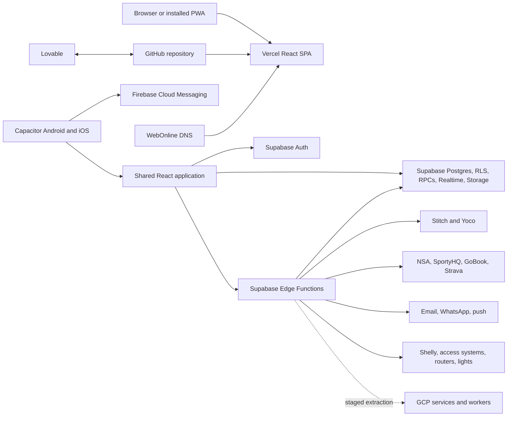

# SquashHub Architecture

Last verified against the repository on 2026-08-25.

## System purpose

Final tournament ladder adjustment is an explicit organiser action via `champ_final_ladder`: club/ladder permission, completion and stale-preview validation precede an atomic refill of participants' existing slots, independently for split ladders. `ladder_update_mode=final_standings` suppresses per-match ladder movement but retains ranking-point awards; existing tournaments remain in legacy match mode until explicitly changed. No view-time or deployment-time ladder backfill occurs.

GoBook balance display shares `GoBookBalance` across My account and Court bookings. API-enabled GoBook clubs call authenticated `gobook-api` action `my_balance`, using the active club member's saved GoBook client ID after owner/existing admin checks. Only that client's balance and provider `asAt` return; no bulk balances, auto-linking, local accounting changes or credit transfers occur.

Prospective Swiss sequencing is stored on `TournamentSpec.swissSequencing` with the actual tournament ID and creation timestamp, minted only by fresh first-stage generation for tournaments created after the safety cutoff. Missing/mismatched/old policies retain legacy behavior. The shared Blossom maximum-weight matcher targets adjacent current ranks in the final configured round, prohibits all previous opponents, gives fair byes, and prioritizes score fairness before preserving adjacency opportunities in earlier rounds. Small even cohorts (up to eight, at most two rounds ahead) use exact bounded edge-disjoint lookahead; larger/odd fields use a soft preservation objective, never speculative future participant identities. Locked RR groups use their unchanged R2 snapshot. Existing Uitsig tournament IDs are frozen across structured commits/generation, setup lifecycle saves, fixture insertion, automatic progression and decided-Swiss writers; display computations remain legacy and read-only. No migration/backfill or hosted rollout accompanies this source change.

Swiss positional pairing uses the shared history-aware `swiss-no-repeat` resolver from round 3 in generation and projections for every club. Saved games remain fixed; rounds 1 and 2 retain their original pairing rules. Unsatisfiable draws stop instead of silently repeating opponents.
For fields with even upper and lower halves, the shared preferred-template adapter pairs opposite quarters within each half in rounds 3–4; repairs respect those boundaries. Uneven halves retain existing rules pending review. Original schedule-slot keys remain independent of revised opponent positions.
Riverside's optional five-round Swiss RR finish is category-configured in Structure, mirrored into the draw spec and stage guards. Both nextSwissRound and decided-fixture projection use the Round-2 snapshot for four-player RR groups in R3–R5; the remainder uses no-repeat Swiss. RR-only live standings and cumulative standings are separate. Scheduling remains manual and category-count validation never creates/deletes rounds.

Booking-grid presentation uses `src/lib/booking-grid.ts` to retain every court-row overlap, ordered by start time. Separate selectable entries show names on their starting row and continuation markers on later rows; booking times, ownership, billing and availability enforcement are unchanged.

Stock product current cost and weighted average are distinct: purchase receipts maintain the latest per-container cost, while the existing opt-in stock engine calculates the average per smallest stock unit. Item editing displays that saved average read-only after container conversion; historical sale snapshots remain immutable.

SquashHub is a multi-tenant platform for squash clubs and the wider squash ecosystem. It combines club SaaS, member self-service, bookings, competitions, league/federation operations, payments, communications, access automation, live scoring, PWA delivery, and native mobile capabilities in one codebase.

## Runtime context

## Application shells and routing

`src/App.tsx` composes providers in this order: React Query, UI providers, router, Auth, Club, and Member. The order matters because club and member state depend on authentication.

The application serves multiple shells:

- Public/root product experience and club directory.
- Club landing pages resolved from host subdomains or `/c/:subdomain` paths.
- Authenticated member shell with bookings, ladder, matches, profile, feed, achievements, availability, notifications, support, and help.
- Club administration for courts, members, events, competitions, finance, communications, and settings.
- Platform administration under `/admin` for clubs, federation, tournaments, users, affiliations, NSA imports, outreach, subscriptions, support, and platform configuration.
- Public or tokenized payment, invitation, unsubscribe, booking response, TV, and live marker routes.

`src/lib/subdomain.ts` resolves the active club from preview state, path routing, hostname, and custom-domain behavior. Platform admin must remain on the root host.

## Identity and authorization

AGM run-offs use `agm_ballots.runoff_parent_id` with a unique direct-child index and an admin-only creation RPC. The server computes candidates tied at the remaining-seat cut-off after the parent deadline; separate child voter/receipt rows preserve all parent records. Public links resolve through the child chain, locking the resolved voter on submission and rejecting stale position payloads. Results stay ballot-scoped and post-deadline; run-off messages use the Communications engine only on an explicit send action.

Club-sponsored stock uses a private shared posting helper for authenticated bar-permission entries and a separate personal-PIN basket RPC. Counter sessions authoritatively determine club/device/name and are locked against revocation during posting. The whole basket is atomic and request-stamped in an RLS-locked service-only audit table; retries return the same result. Stock uses `bar_stock_apply`; cost moves from the item's trading expense to `club_stock_expense`, never through customer tabs, cash, sales or tips.

`AuthContext` owns the Supabase user and session. `ClubContext` resolves the active public and restricted club context. `MemberContext` resolves member records and the user's relationship to the club.

Authorization spans:

- platform super-admin roles;
- organization and association administrators;
- club roles and custom permissions;
- member access and status gates;
- club capabilities and subscription packaging;
- public/tokenized workflows;
- RLS and privileged Edge Functions.

UI gates improve navigation but do not replace RLS or server-side authorization.

## Core domain model

### Organizations and people

`organisations`, `clubs`, `people`, private people data, affiliations, profiles, club members, association memberships, organization relationships, roles, permissions, and audit events establish identity and organizational structure.

### Bookings and facilities

`courts`, `bookings`, recurring bookings, booking invites, visitors, reflow logs, light sessions, access events, router configurations, and access provisioning logs connect scheduling to physical facilities.

Family booking authority is checked by `can_book_linked_member`: direct ownership or the authenticated actor's verified shared email plus an owned membership in the same club. Eligibility and the booking trigger share this check, independently of fee delegation and family billing groups. The booking records the authenticated actor in `user_id` and the selected playing member in `club_member_id`; approved credit and recurring coverage belong to that selected member. Adjacent booking merges require matching member IDs as well as opponent details. No client profile selection grants authority.

### Matches, ladders, and rankings

Matches, challenges, ladder history, ranking ledgers, pending ranking points, streaks, badges, and correction/dispute records form the player competition history.

### Tournaments and club championships

Tournaments, venues, rules, governance, draw versions, rounds, entries, doubles pairs, marker locks, schedules, and invite delivery support multiple formats. Pure domain behavior is concentrated in `src/lib/tournaments/` and `src/lib/tournament-formats/` and is heavily tested.

Confirmed next-round Swiss candidates share the progress-log projection. Applied self/play-by rounds create saved fixtures without a court booking and use their own round row's deadline; scheduled rounds retain planned-slot creation and booking. Saved participants are excluded from generation. Court-grid projections remain scheduled-only. Server release and existing-game repair remain separate explicit actions.

### Leagues and federation

League associations, seasons, rules, teams/pairs, rounds, fixtures, lineups, availability, results, penalties, national bodies, affiliations, licenses, and NSA history support club-to-federation workflows.

### Billing, payments, and bar

Payroll review permits quantity/rate, salary, tips and total edits; confirmation stores original and approved values in `bar_payroll_run_lines.review`, retaining server authority, unpaid-tip caps and EFT accounting. Read-only month-end preview calculates current accrued pay from the existing overview without preparing or confirming a run; hypothetical edits are local only.

Bar staff supports monthly, per-shift and hourly pay. `bar_work_shifts` groups concurrent attendance until cash-up; `bar_staff_attendance` records PIN-derived individuals, actual entry, paid start and exit, with append-only correction snapshots for unpaid/unallocated records. Special shifts explicitly choose own tips, hours-weighted sharing or equal sharing among distinct staff with paid hours. Nullable `tip_sharing_mode` preserves legacy `split_tips` behavior; the new PIN-authorised start RPC locks and retains the existing shift's policy. Shared tips retain original sale attribution and append deterministic cent allocation records plus balanced income reclassification; `bar_staff_tip_earnings` is the consistent balance/payout source. Unallocated tips are withheld and zero-hour shifts require explicit management review. Payroll snapshots its attendance cutoff so hours after preparation remain eligible next period, retains manual overrides, and records only approved salary/tips against bank_current and Bar cost of sales. No historical attendance is invented or historical tips reallocated.

Member Billing offers a separate outstanding-balance adjustment. `admin_add_member_outstanding_balance` validates the active club/member and existing billing authority, posts only member-linked debtors and opening balance equity atomically, and audits a stable request ID. It creates neither a fee assessment nor a payment; retries cannot duplicate the debt. Existing fee billing and payment flows remain separate.

Optional tips and cash-up settings default off. Tip records are separate from merchandise; confirmed cash/terminal tips earn named Bar income, and cash payouts post named Bar cost of sales. Member-account tips remain account_due against creditors until the account is covered, then earn income exactly once. Staff payouts serialize by staff identity and use stable request IDs. Counter attribution comes from a validated personal PIN session, not a client-selected staff ID. Paid-tip tabs cannot reopen without an audited correction. Online tips are fail-closed behind online_tips_ready until checkout amount/currency verification and atomic provider settlement are released; no payment functions are deployed in this phase. Cash-up currently exposes only the approved enable switch, not a reconciliation workflow.

Saved cash-up editing uses an authenticated reason-required full correction RPC for cash/card counts, named payouts, reconciliation choice and note. Expected-original snapshots reject stale edits. Corrections retain shift boundaries and append balanced adjustments; changing historical counted cash also recalculates and audits the immediate next shift's opening/reconciliation without changing its counted cash. Historical payout additions are bounded by both shift-earned and current unpaid tips. No cash-up is deleted or reopened.

Counter sale attribution resolves the allocated named PIN credential from its valid server-side session; visitor entries keep that credential ID and a name snapshot, copied unchanged into member-account entries. Handovers affect new lines only, not earlier customer or staff sales; client-provided operator names are not authority.
Shared-device counters retain separate venue-scoped verified PIN sessions and select one active serving token, re-fetching its authorized board and attendance before serving. Adding/selecting a barman does not end another person's attendance; shared End shift asks for explicit person/all selection, while confirmed device exit closes the locally retained participants. Existing cash-up still closes the whole work shift across devices. Session selection is blocked during an unposted basket or payment action.

Shop trading uses distinct standard income/expense GL accounts. Sale routing preserves existing receivable/payment timing and grouped receipt idempotency; purchase journals remain keyed by their source reference alongside unchanged inventory movements. Purchases-basis reporting includes invoice-linked stock debits and explicit expense-to-stock reclassifications, without including stocktake movements or duplicating legacy purchase expenses. Cost-of-sales basis substitutes historical inventory sale snapshots for these purchase rows without writing journals. Named custom accounts select Bar/Shop cost-of-sales reporting categories while retaining Expense ledger semantics. Statements resolve custom IDs into the selected division, exclude those lines from general expenses, and preserve legacy direct-cost roll-ups without duplicating costs. Finance-authorized, club-scoped cost reads use Johannesburg sale-date boundaries and flag missing snapshots; item division currently comes from the club-owned item. Historical transactions are not reclassified or reposted automatically because manual/bank entries may already account for them.

Member fees, fee categories, club subscriptions, platform invoices, mandates, payment sessions, collections, payable batches, ledger entries, bar items, stock, tabs, and visitor sales connect club operations to finance.

Tournament fee adjustments compare targets to net fee-linked tournament-income assessments rather than mutable remaining debt, retaining applied partial payments. Paid/invoiced guards and top-up/provider/recurring handlers are unchanged.

Member self-opened tabs are shared `bar_guest_tabs` records opened by `open_my_bar_tab` (authenticated, active own membership, club-scoped, serialized and reused while open/closing). `opened_source` marks in-app origin independently of serving identity. HonestyBar hands off to the existing ScanPay tab/order/receipt flow; selected items remain drafts until submitted. Counter polling discovers the shared tab without reload; existing PIN and settlement checks remain authoritative.

HonestyBar now sends orders before settlement: `placeMemberCounterOrder` opens/reuses an own-member shared tab via `open_my_bar_tab`, submits collect-at-bar items through `bar_submit_guest_order` with a stable retry key, and navigates to ScanPay only after success. The order creates unpaid tab sales and counter order lines, not a member account debit; ScanPay retains existing separate account-charge/payment authority. Existing club order-process settings remain required; rejected ordering preserves the basket. The earlier `submit_my_bar_account_order` remains backward-compatible but is no longer used by HonestyBar. No historical sales are converted.

### Communications and engagement

Campaigns, recipients, templates, email outbox/state, suppression, notifications, push subscriptions, WhatsApp interactions, feed posts, comments, reactions, outreach prospects, links, and event tracking support engagement and growth.

## Backend architecture

### Supabase data plane

The browser and native app use Supabase clients for authenticated data access. RLS is therefore a primary security control. The migration history is large and encodes schema, security policies, RPCs, cron jobs, triggers, and operational fixes. Always add migrations; never rewrite applied history.

Realtime is important for bookings, live markers, notifications, and operational dashboards. New subscriptions must be narrowly filtered and cleaned up on navigation or context changes.

### Edge Functions

Edge Functions implement privileged and integration-heavy workflows, including:

- payments, mandates, collections, callbacks, and reconciliation;
- NSA/federation sync, fixture and result exchange, and member provisioning;
- email, WhatsApp, push, campaigns, outreach, and queue processing;
- access provisioning, court lights, Shelly devices, router polling, and diagnostics;
- GoBook, SportyHQ, Strava, and other external integrations;
- subscriptions, invoicing, billing, and trial notifications;
- public booking, invite, visitor, and token workflows.

Functions must validate callers, tenant/club scope, provider signatures, and idempotency before privileged writes.

## Web, PWA, and native architecture

The React app is shared across web and Capacitor. Platform-specific helpers encapsulate deep links, native browser behavior, BLE, push, orientation, geolocation, and local notifications.

- Web/PWA push uses service workers and VAPID.
- Native push uses Firebase Cloud Messaging through Capacitor plugins.
- Mobile OAuth and payment flows may open external browser surfaces and return through deep links.
- Android and iOS projects are synchronized from the web build with Capacitor.

See `MOBILE.md` and Android docs before editing native configuration.

## Deployment and operations

- The web application deploys from `main` to Vercel where configured.
- WebOnline manages product and wildcard tenant DNS.
- Supabase migrations, functions, secrets, and cron schedules deploy separately.
- Capacitor native builds have separate signing, store, Firebase, and release processes.
- Lovable may generate commits and uses connected cloud APIs in parts of the codebase.
- Remotion is a separate tooling surface and should not be included in the main app bundle accidentally.

## Migration direction: Supabase to GCP

The safest extraction sequence is workload-first:

1. Define typed boundaries around external providers and scheduled jobs.
2. Move polling, queue processing, outreach, notification dispatch, media work, and device orchestration to authenticated Cloud Run services or workers where justified.
3. Use Pub/Sub or Cloud Tasks only where delivery semantics, retries, ordering, and dead-letter behavior are explicitly designed.
4. Publish outbox events from the current source-of-truth transaction instead of dual-writing from UI code.
5. Build reconciliation views for payments, bookings, access events, notifications, and federation sync.
6. Migrate primary competition or booking data only after realtime, latency, offline, and rollback requirements are proven.

GCP already participates indirectly through Firebase and Google OAuth configuration, but this does not mean the main backend has migrated.

## Architectural risks

- The product has a very large schema and Edge Function surface, increasing coupling and deployment-order risk.
- Device and external sports integrations are unreliable by nature and need observability and safe retries.
- One shared application serves public, member, club-admin, association, platform, PWA, and native use cases.
- Subdomain, preview, path-based, and custom-domain routing can diverge.
- Payment and competition workflows have complex state transitions across tables and functions.

The strongest mitigation is to preserve domain libraries and tests, centralize integration boundaries, enforce tenant scope, and add reconciliation rather than hidden retries.

## Change impact checklist

- club, organization, member, and platform authorization;
- RLS, RPCs, migrations, generated types, and cron jobs;
- tournament/league invariants and test coverage;
- booking, access, lights, router, and visitor side effects;
- payment verification, idempotency, and reconciliation;
- web, PWA, Android, iOS, deep links, and push;
- subdomains, custom domains, Vercel, and WebOnline DNS;
- external provider contracts, quotas, and credentials;
- GCP extraction contracts, logs, retries, cost, and rollback.
